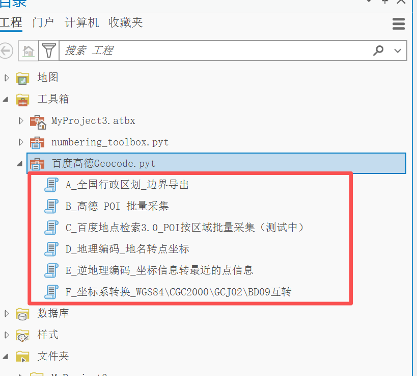
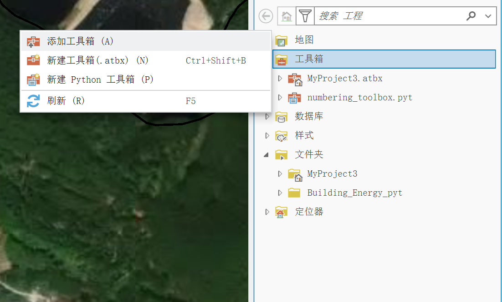
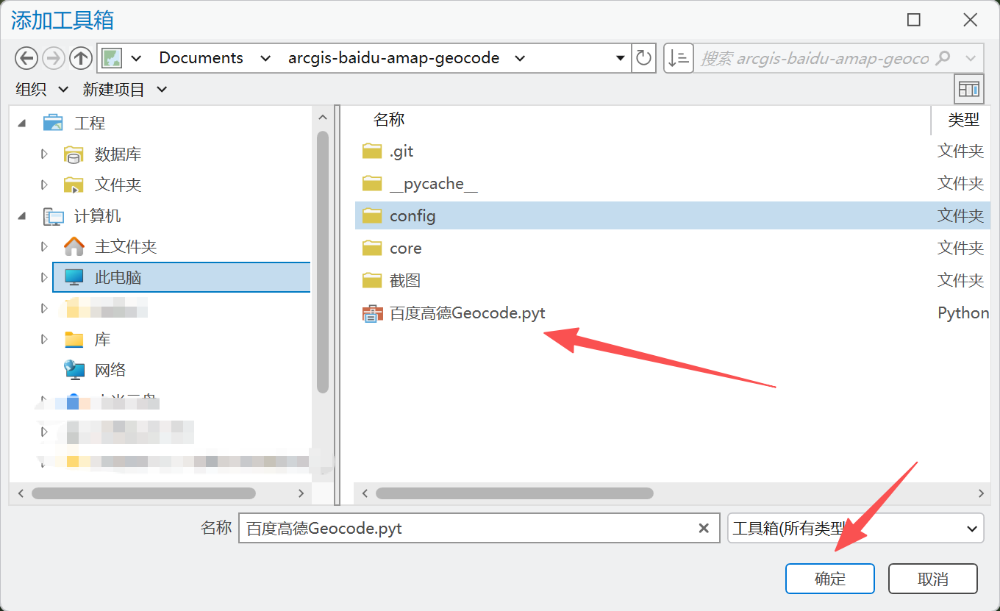
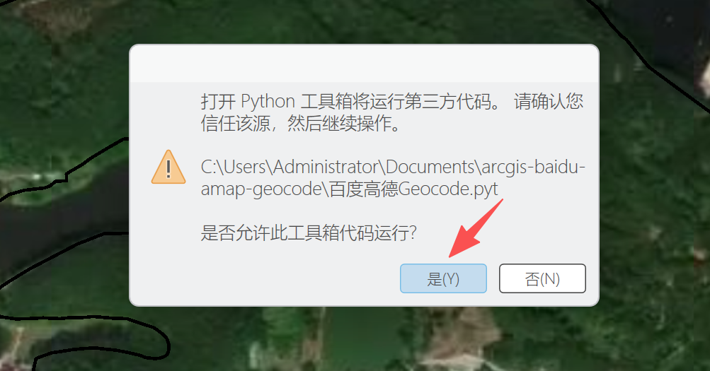
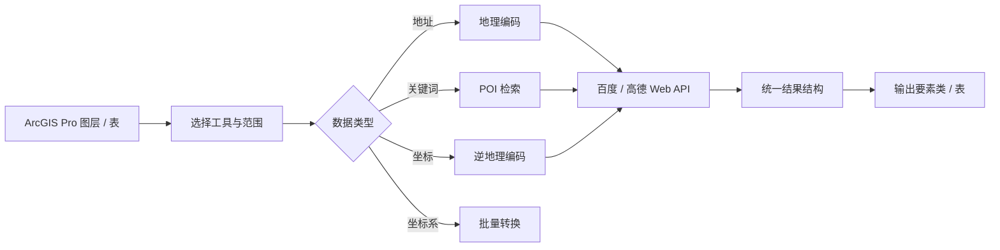

**QQ 交流群：826861025**

<div align="center">
  
  <h1>百度 / 高德地理编码工具箱</h1>
  <p>把 POI 检索、地址匹配、逆地理编码和坐标转换装进 ArcGIS Pro</p>
  <p>
    
    
    
    <a href="./LICENSE"></a>
  </p>
</div>

## ❤️ 赞助商

<a href="https://jizhanai.top/register?ref=PBUXGDHTFUAS">
  
</a>

<table>
  <tr>
    <td width="24%" align="center">
      <a href="https://jizhanai.top/register?ref=PBUXGDHTFUAS"></a>
    </td>
    <td>感谢 <a href="https://jizhanai.top/register?ref=PBUXGDHTFUAS"><b>极栈 · jizhanai.top</b></a> 赞助支持本项目！极栈提供 <b>ChatGPT 会员充值</b>服务，支持<b>支付宝支付</b>。选购 <b>ChatGPT 激活码</b>后，按站内指引前往码港兑换。<br><br>通过<a href="https://jizhanai.top/register?ref=PBUXGDHTFUAS">邀请链接注册开通</a>，填写邀请码 <code>PBUXGDHTFUAS</code>，可减 <b>5 元</b>。</td>
  </tr>
</table>



## 30 秒看懂

这是一个 **ArcGIS Pro Python 工具箱（`.pyt`）**，把中国业务里常见的位置数据准备工作收进 6 个工具：行政区边界导出、高德 / 百度 POI 采集、地址转坐标、坐标转附近信息、常用坐标系批量转换。

适合做前期调研、选址分析、设施普查、地块匹配和成果落图的人。你只需要准备 ArcGIS Pro 和自己的百度 / 高德 Key；工具在本机调用 Web 服务 API，不要求额外安装 Python 环境。

> 本工具箱不支持 ArcMap 或 ArcGIS Desktop 10.x。API Key 必须自行申请，仓库不内置任何 Key。

## 功能矩阵

| 工具 | 你能做什么 | 输入 | 输出 |
| --- | --- | --- | --- |
| **A_全国行政区划_边界导出** | 省 / 市 / 区县级联选择并导出边界 | 行政区划选择 | 面要素 |
| **B_高德 POI 批量采集** | 按关键词、分类和范围采集 POI | 范围、关键词 / 分类 | POI 要素 |
| **C_百度地点检索3.0** | 在矩形区域内批量检索地点 | 矩形范围、关键词 | POI 要素 |
| **D_地理编码_地名转点坐标** | 把地址表批量转成坐标点 | 地址表、地址字段 | 点要素类 |
| **E_逆地理编码_坐标信息转最近点信息** | 查询坐标附近的 POI 信息 | 点坐标 | 长表 / 要素 |
| **F_坐标系转换** | 在 WGS84、GCJ02、BD09、CGCS2000 间转换 | 坐标表 | 转换结果 |

## 环境要求

| 项目 | 要求 |
| --- | --- |
| 软件 | ArcGIS Pro **3.0 及以上** |
| Python | 随 ArcGIS Pro 自带 3.x，无需单独安装 |
| 服务账号 | 百度地图 Key 和 / 或高德 Key |
| 不支持 | ArcMap、ArcGIS Desktop 10.x |

## 三步上手

| 步骤 | 操作 | 结果 |
| --- | --- | --- |
| 1 | 下载或克隆仓库，在 ArcGIS Pro「目录」窗格添加 `百度高德Geocode.pyt` | 工具箱出现在 Pro 中 |
| 2 | 在 `config/` 中填写百度或高德 Key | 工具可以调用对应服务 |
| 3 | 选择工具，设置范围、关键词、字段和输出位置 | 生成点、边界或转换结果 |

## 安装截图

<table>
  <tr>
    <td width="50%" align="center"><br><sub>1. 添加工具箱</sub></td>
    <td width="50%" align="center"><br><sub>2. 选择 .pyt 文件</sub></td>
  </tr>
  <tr>
    <td width="50%" align="center"><br><sub>3. 允许运行</sub></td>
    <td width="50%" align="center"><br><sub>4. 查看工具列表</sub></td>
  </tr>
</table>

## 配置 Key

工具箱不会内置 Key。你可以在 `config/baidu_keys.txt` 和 `config/amap_keys.txt` 中分别填写。每行一个 Key，`#` 开头的行为注释；多个 Key 可提高并发和配额余量。

```text
config/
├── baidu_keys.txt   # 百度 Key
└── amap_keys.txt    # 高德 Key
```

| 服务 | 申请入口 | 应用类型 |
| --- | --- | --- |
| 百度地图 | <https://lbsyun.baidu.com/apiconsole/key> | 服务端 |
| 高德地图 | <https://console.amap.com/dev/key/app> | Web 服务 |

只用高德工具时，可以只填高德 Key；只用百度工具时，可以只填百度 Key。详细字段和示例见 [CONFIG.md](CONFIG.md)。

## 数据处理流程



高德 POI 采集在单区域结果超过分页上限时会自动递归拆分为 4 个子象限，减少漏采；百度地点检索 3.0 必须填写关键词，不支持空关键词全量搜索。

## 典型场景

| 场景 | 推荐工具 | 说明 |
| --- | --- | --- |
| 项目区现状设施盘点 | B / C | 按关键词和范围采集 POI，输出后检查类别和数量 |
| 客户地址批量落图 | D | 读取地址表，转换成点要素后复核失败地址 |
| 选址周边配套分析 | E | 输入候选点，查询附近服务设施 |
| 行政边界核对 | A | 导出省市县边界，与业务范围叠合检查 |
| 多源坐标统一 | F | 在百度、高德、GPS 和 CGCS2000 坐标间转换 |

## 坐标系

| 坐标系 | 常见别名 | 说明 |
| --- | --- | --- |
| WGS84 | EPSG:4326 | 国际标准，GPS 常用 |
| GCJ-02 | 火星坐标系 | 国测局坐标，高德、腾讯使用 |
| BD-09 | 百度坐标系 | 百度地图专用坐标 |
| CGCS2000 | 2000 国家大地坐标系 | 中国官方大地基准，本工具按 WGS84 等值处理 |

转换关系：`BD-09 → GCJ-02 → WGS84 ↔ CGCS2000`。输出空间参考统一写为 WGS84；选择 GCJ-02 输出时，坐标值保留 GCJ-02，但空间参考字段仍为 WGS84。

## 并发与速度

| 档位 | 并发策略 | 适用 |
| --- | --- | --- |
| 低（稳定） | 使用 25% Key 理论并发量 | 免费 Key、小数据量 |
| 中（平衡） | 使用 50% Key 理论并发量 | 多 Key、批量任务 |

并发线程数根据 Key 数量和档位自动计算，单个 Key 按 30 QPS 估算。

## 输出与注意事项

| 主题 | 说明 |
| --- | --- |
| 输出位置 | 建议 File Geodatabase（`.gdb` 目录）或勾选临时空间 |
| 空间参考 | 输出统一写为 WGS84 (EPSG:4326) |
| 高德 POI | 高密度区域自动递归拆分，减少分页漏采 |
| 百度 POI | 必须填写关键词，不支持空关键词全量搜索 |
| 数据合规 | 遵守百度 / 高德服务条款，不要采集或存储敏感个人数据 |

## 仓库结构

| 路径 | 说明 |
| --- | --- |
| `百度高德Geocode.pyt` | ArcGIS Pro Python 工具箱入口 |
| `core/` | 服务调用、结果解析、坐标转换和公共逻辑 |
| `config/` | 百度 / 高德 Key 配置文件 |
| `截图/` | 安装步骤截图 |
| `CONFIG.md` | Key 申请与配置细节 |

## 常见问题

| 现象 | 处理 |
| --- | --- |
| 工具箱无法运行 | 确认使用 ArcGIS Pro 3.x；ArcMap 不支持 |
| 请求失败 | 检查 Key 是否有效、类型是否正确、配额是否用尽 |
| POI 数量偏少 | 收紧范围、拆分关键词，或提高速度档位后重试 |
| 坐标偏移 | 先确认源坐标系，再选择对应目标坐标系 |

## 社区反馈

| 场景 | 入口 |
| --- | --- |
| 缺陷、接口变化、字段建议 | [GitHub Issues](../../issues) |
| 使用讨论 | QQ 交流群：826861025 |

反馈时请附 ArcGIS Pro 版本、工具名、参数截图和脱敏日志；不要公开 Key 或业务数据。

## 关注与赞赏

扫码关注「极思G工作室」公众号、加入 QQ 交流群，获取工具更新、交流使用经验：


如果这些工具对你有帮助，欢迎赞赏支持。赞赏完全自愿，感谢你的支持。


## License

[MIT](./LICENSE)

百度地图、高德地图及相关名称属于其各自所有者；本项目与这些平台无隶属关系。
